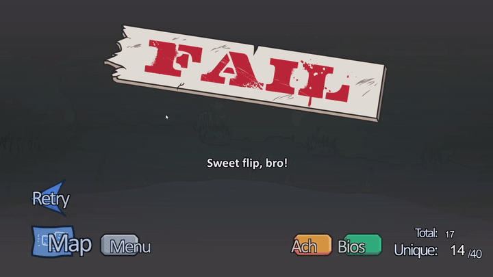
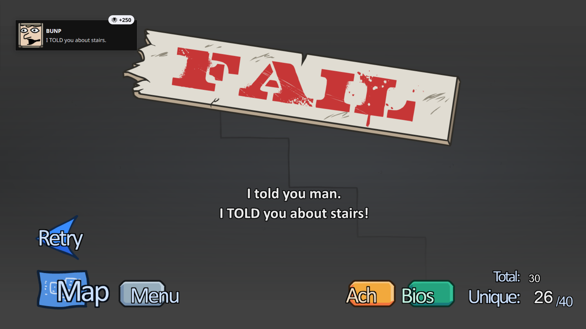

# Achievement Bridge for Hydra Launcher

> **Alright folks, this thing drove me up the wall — so I went and fixed it!!**
> This repo reroutes your achievements into Hydra Launcher. That bug annoyed the hell
> out of me for ages, so I built a fix and figured I'd share it. Enjoy!)

**This isn't just a bridge for a couple of emulators — it knows pretty much all of them.**

**A full pass takes about a second.** Real run: 4 bridges at once (The Henry Stickmin
Collection — 8 achievements, Nodebuster — 13, Click the Button — 9, Moon Sweepers — 8),
done in 1 second. It runs in the background while you play.

**Hydra Launcher only looks for achievement files at a fixed set of paths. This script
finds them anywhere else on your PC and copies them where Hydra is guaranteed to read them.**

`Python 3.8+` · no third-party libraries · Windows · [Русская версия](README.md)

> Heads up: the script talks to you in Russian. The code is plain Python and
> `--help` lists every option, but the console output and comments are Russian.

---

## Why you'd need this

Hydra scans achievement files only at specific paths, always inside a folder named
after the game's Steam appid, like this:

```
%APPDATA%\GSE Saves\<appid>\achievements.json
C:\Users\Public\Documents\Steam\RUNE\<appid>\achievements.ini
```

When the emulator behaves, everything is fine. **Carrion** is a good example: its
emulator acts almost like real Steam, drops achievements exactly where they belong,
and Hydra shows them with no hacks needed. Games like that need no fixing — and the
script leaves them alone.

But sometimes it's a whole different story, and you get zero achievements in the
launcher. Three common cases:

1. **The emulator saves somewhere else.** Some of them (SOVEREIGN, for one) keep
   achievements inside their own `.ini` file next to the game. Hydra never looks there.
2. **The appid got lost.** If `steam_appid.txt` holds junk instead of a number, the
   emulator has no idea which game it is and dumps everything into a folder named `0`.
   Hydra looks in the folder with the real appid and finds nothing. (A very common
   stand-in is `480` — that's Spacewar, Valve's own test app — and the script ignores it.)
3. **There's no emulator at all.** An antivirus ate the cracked `steam_api.dll` and the
   genuine Valve one is left behind. The game's Steam API never initialises, so
   achievements are only tracked by the game's own save file.

The script handles all three: it finds the achievements, works out which game they
belong to, and copies them where Hydra will definitely see them.

---

## See it in action

[](media/henry-achievement.mp4)

Most of the time Henry Stickmin dumps its achievements in some hole Hydra never looks
into. In the clip the achievement pops on screen — and the launcher is still empty,
because it lives in the game's own folder under `%APPDATA%`, not where Hydra searches.
That's exactly what this bridge is for: it grabs them there and drops them where they
belong. Unlock it in-game and boom — it's already in Hydra, zero fiddling.

*(click the image for the full 23-second clip)*

And here's a second one, from "Stealing the Diamond" — **BUNP. I TOLD you about stairs.**
Popped in-game, and the bridge picked it up along with the rest.



---

## Features

- **50+ known locations** across Goldberg, GSE, CODEX, RUNE, EMPRESS, OnlineFix,
  SKIDROW, SmartSteamEmu, CreamAPI, RLD!, Reloaded/3DM, DODI, ALI213,
  Hoodlum/DARKSiDERS, RLE, Razor1911, TENOKE, KaOs — plus emulator configs and save
  folders inside the game directory itself.
- **All known formats**: every INI flavour, Goldberg/EMPRESS JSON, SmartSteamEmu's
  binary `stats.bin`, the GreenLuma registry.
- **Unknown formats still work**: any file that looks like achievement data gets run
  through every parser in turn, so new emulators usually just work with no code changes.
- **Any encoding**: UTF-8, cp1251, UTF-16, with or without a BOM. Old INI files from
  Russian repacks read just fine.
- **Safe writes**: files are written to a temp copy and swapped in one move (`os.replace`),
  so Hydra never sees a half-written file — and the previous content stays next to it as `.bak`.
- **Lost appid recovery**: achievements in a nameless folder (like `GSE Saves\0`) are
  matched against each game's achievement schema and routed to the right game.
- **Emulator detection**: reports which emulator a game folder uses, and warns when the
  emulator is missing (genuine Valve DLL present).
- **Game-side saves**: if a game tracks its own achievements (say, a Godot game's
  `save.json`), the script reads it and derives the internal-name → Steam-api-name map
  straight from the game's own files.
- **Adobe AIR games**: Flash ports keep progress in `%APPDATA%\<id>\Local Store` as
  compressed `.sav` files — the script unpacks them and pulls the achievements out.
- **Windows registry**: GreenLuma (which keeps progress in the registry) plus a general
  sweep of `HKCU\Software`, for any emulator that writes there.

Output goes to `%APPDATA%\GSE Saves\<appid>\achievements.json` in Goldberg format — the
one place Hydra reads for *any* crack. Existing foreign files are never overwritten; if
that slot is taken, the script falls back to
`%APPDATA%\Goldberg SteamEmu Saves\<appid>\achievements.json`.

---

## How it's different from other bridges

Tools like this are rare, and almost all of them are narrow: one or two emulators,
manual setup, a window full of buttons you have to keep open. This one goes the other way.

| | Typical bridges | This one |
|---|---|---|
| Emulators | one or two (usually RUNE and Goldberg) | 50+ locations, every known format |
| Unknown format | ignored | a sniffer runs every parser on the file |
| Lost appid | achievements just aren't found | routed by matching names against game schemas |
| Game's own achievement tracking | usually no | Godot and Adobe AIR saves |
| Windows registry | rarely | GreenLuma + a general `HKCU\Software` sweep |
| Setup | drag a folder into a window, run as admin | one line in `roots.txt`, or nothing at all |
| How it runs | while its window is open | quietly from startup, once a minute |
| Antivirus | an `.exe` Defender sometimes eats | a plain `.py` script — nothing to flag |

And it never touches your game folders and never needs admin rights.

---

## Install and run

1. Install Python 3.8+ (tick **Add Python to PATH**).
2. Put this folder anywhere you like, e.g. `C:\Tools\hydra-achievements-bridge`.
3. Open `roots.txt` and list your game folders, one per line. The two most common
   ones (`C:\Games` and `D:\Games`) are already built into the script, so if your
   games live there you can leave this file alone entirely:

```
C:\Games
D:\Games
E:\SteamLibrary\steamapps\common
```

4. Run `run.bat`, then read `report.txt` — it says what was found and where it went.

Want a dry run first? `check.bat` shows everything without writing a thing.

```
python bridge.py                     normal run
python bridge.py --dry-run           show what would happen, write nothing
python bridge.py --watch 60          keep checking every minute
python bridge.py --roots E:\Games    add a game folder
python bridge.py --online            allow appid lookups in the Steam store
python bridge.py --quiet             short report
```

Optional autostart: `autostart-on.bat` drops a `pythonw.exe ... --watch 60` shortcut
into your Startup folder; `autostart-off.bat` removes it. No admin rights, no services,
no registry changes. Only one watcher can run at a time — a second one sees the
`bridge.lock` and quits.

**Note:** Hydra reads these files at startup — restart it once after the first run.

---

## What it never does

- Never deletes or modifies anything inside game folders — it only reads there.
- Never downloads achievements; it only transfers what was actually earned locally.
- Never touches files it didn't create (`state.json` remembers its own files).
- Needs no administrator rights and installs nothing system-wide.

---

## Credits

Storage locations and file formats were learned from
[Achievement Watcher](https://github.com/xan105/Achievement-Watcher) and
[Hydra Launcher](https://github.com/hydralauncher/hydra). Thanks to their authors.

Author: **frocux**.

## License

MIT — see [LICENSE](LICENSE).
