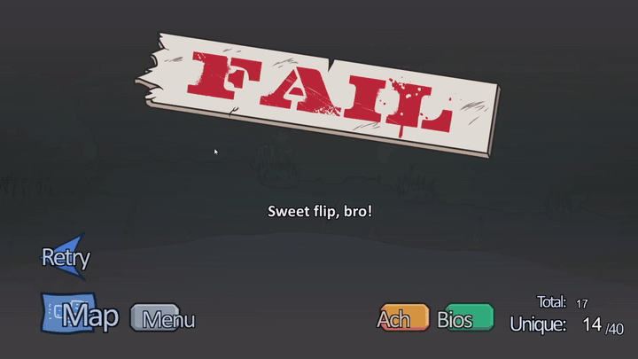
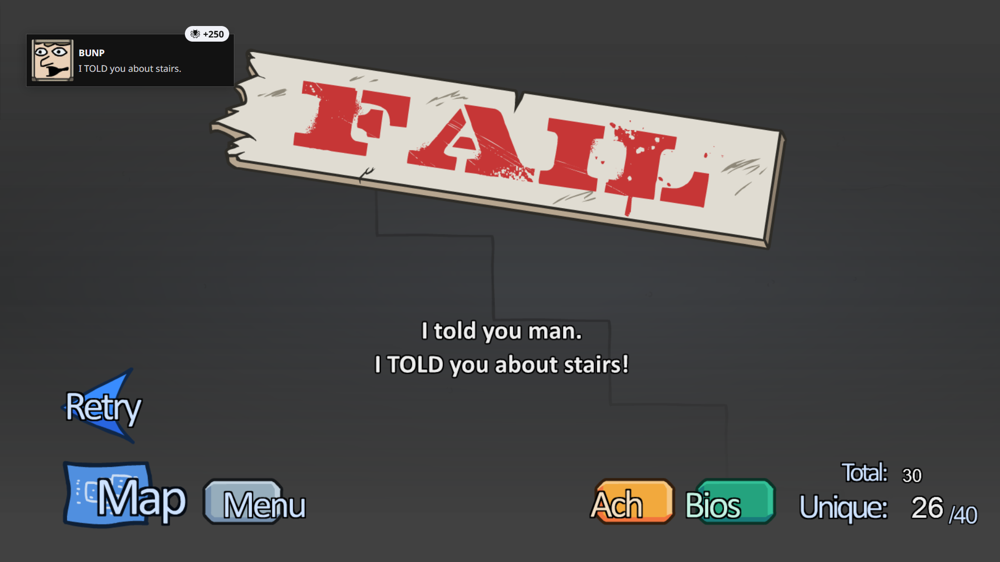

# Мост достижений для Hydra Launcher

> **Ребят, эта херня меня реально задолбала — и я решил её починить!!**
> Этот репозиторий перенаправляет достижения в Hydra Launcher. Проблема бесила меня
> огромное количество времени, так что я сделал решение и делюсь с вами)) Пользуйтесь!)

**Это не просто мостик между парой эмуляторов и Hydra — он знает 19 эмуляторов
и около 70 мест, где те прячут достижения.**

**Прогон — буквально секунда.** Живой пример: 4 моста разом (The Henry Stickmin
Collection — 8 достижений, Nodebuster — 13, Click the Button — 9, Moon Sweepers — 8) —
итого 1 секунда. Играть можно, пока он работает в фоне.

**Hydra Launcher видит достижения только по строго заданным адресам. Этот скрипт сам
находит их где угодно ещё и переносит туда, где Hydra их точно прочитает.**

`Python 3.8+` · без сторонних библиотек · Windows · [English version](README.en.md)

---

## Зачем это нужно

Hydra ищет файлы достижений **только по строго определённым адресам** и всегда в папке
с номером игры (appid). Примерно так:

```
%APPDATA%\GSE Saves\<номер игры>\achievements.json
C:\Users\Public\Documents\Steam\RUNE\<номер игры>\achievements.ini
```

Пока эмулятор аккуратный — всё хорошо. Например, **Carrion**: там эмулятор почти как
настоящий Steam, он сам кладёт достижения куда надо, и Hydra их показывает без всяких
костылей. Трогать такие игры не нужно, скрипт их и не трогает.

А бывает иначе, и тогда достижений в лаунчере нет вообще. Три частых случая:

1. **Эмулятор пишет в незнакомое место.** Некоторые (например SOVEREIGN) складывают
   достижения прямо в свой `.ini` рядом с игрой. Hydra туда не смотрит вообще.
2. **Номер игры потерялся.** Если в `steam_appid.txt` вместо числа написана какая-то
   ерунда, эмулятор не понимает, что за игра, и сваливает всё в папку `0`. Hydra ищет
   в папке со своим номером — и не находит ничего.
3. **Эмулятора вообще нет.** Антивирус съел подменную `steam_api.dll`, осталась родная
   от Valve. Steam-API в игре не поднимается, достижения нигде не копятся — кроме
   собственного сохранения самой игры.

Скрипт лечит все три: находит достижения, сам разбирается, чьей игре они принадлежат,
и перекладывает туда, куда Hydra точно смотрит.

---

## Как это выглядит

[](media/henry-achievement.mp4)

Чаще всего Генри Стикман кидает свои достижения туда, куда Hydra вообще не смотрит.
Вот на видео ачивка вылезла — а в лаунчере пусто, потому что лежит она в собственной
папке игры в `%APPDATA%`, а не там, где Hydra ищет. Ровно для этого и есть этот мост:
он забирает их оттуда и кладёт куда надо. Открыл ачивку — она уже в Hydra, руками
ничего трогать не надо.

*(клик по картинке — полное видео, 23 секунды)*

А вот вторая, уже из «Stealing the Diamond» — **BUNP. I TOLD you about stairs.**
Тоже вылезла в игре, и мост её спокойно подхватил вместе с остальными.



---

## Что он умеет

| Умение | Как это выглядит на практике |
|---|---|
| **Около 70 мест, 19 эмуляторов** | 50 адресов поиска плюс 18 базовых папок. Знает Goldberg, GSE, CODEX, RUNE, EMPRESS, OnlineFix, SKIDROW, SmartSteamEmu, CreamAPI, RLD!, Reloaded/3DM, DODI, ALI213, Hoodlum/DARKSiDERS, RLE, Razor1911, TENOKE, KaOs и SOVEREIGN — плюс конфиги и сохранения прямо в папке игры |
| **Все известные форматы** | INI во всех видах, JSON Goldberg/EMPRESS, бинарный `stats.bin` SmartSteamEmu, реестр GreenLuma |
| **Незнакомый формат — не беда** | Если файл похож на достижения, скрипт пробует на нём все разборщики по очереди. Новые эмуляторы обычно подхватываются сами, без правок кода |
| **Любая кодировка** | UTF-8, cp1251, UTF-16 — и с меткой в начале, и без. Старые INI от русских репаков читаются как миленькие |
| **Потерянный номер игры** | Раскладывает достижения по играм, сверяя названия со схемами достижений (`steam_settings\achievements.json` в папке игры) |
| **Определяет эмулятор** | Смотрит на файлы игры и пишет в отчёт, какой там эмулятор — и предупреждает, если он не работает |
| **Свои сохранения игр** | Если игра сама ведёт учёт достижений (например Godot-игра в `save.json`), скрипт читает и его, а карту «внутреннее имя → имя в Steam» достаёт прямо из файлов игры |
| **Игры на Adobe AIR** | Flash-порты держат прогресс в `%APPDATA%\<id>\Local Store`, в сжатых `.sav` — скрипт распаковывает их и достаёт оттуда достижения |
| **Реестр Windows** | GreenLuma (там прогресс в реестре) и вообще обход `HKCU\Software` — на случай эмуляторов, которые пишут туда |

Куда переносит: в `%APPDATA%\GSE Saves\<номер игры>\achievements.json` в формате
Goldberg. Это единственное место, которое Hydra читает **для любого** крака,
поэтому одного файла хватает всем.

Если в `GSE Saves\<номер игры>` уже лежит чужой файл (настоящие сохранения игры) —
скрипт его не трогает, а пишет в запасное место
`%APPDATA%\Goldberg SteamEmu Saves\<номер игры>\achievements.json`.

---

## Чем он отличается от других мостов

Таких инструментов наперечёт, и почти все они узкие: один-два эмулятора, ручная
настройка, окно с кнопками, которое нужно держать открытым. Здесь другой подход.

| | Обычные мосты | Этот |
|---|---|---|
| Эмуляторы | один-два (чаще всего RUNE и Goldberg) | 19 эмуляторов, около 70 мест, все известные форматы |
| Незнакомый формат | не читается | «нюхач» пробует на файле все разборщики |
| Номер игры потерялся | достижения просто не находятся | раскладываются по играм сверкой со схемами |
| Свой учёт достижений игры | обычно нет | сохранения Godot и Adobe AIR |
| Реестр Windows | редко | GreenLuma + общий обход `HKCU\Software` |
| Настройка | тащить папку в окно, права администратора | одна строка в `roots.txt` или вообще ничего |
| Как работает | пока открыто окно | тихо, из автозагрузки, раз в минуту |
| Антивирус | `.exe`, который Defender иногда съедает | обычный `.py`-скрипт: ругаться не на что |

Плюс он никогда не трогает папки игр и не требует прав администратора.

---

## Установка

1. Нужен Python 3.8 или новее ([python.org](https://www.python.org/downloads/),
   при установке галочка **Add Python to PATH**).
2. Скачай папку с этим файлом куда угодно — например `C:\Tools\hydra-achievements-bridge`.
3. Открой `roots.txt` и впиши папки, где лежат игры, по одной в строке.
   Две самые ходовые (`C:\Games` и `D:\Games`) уже прописаны прямо в скрипте,
   так что если игры лежат там — этот файл можно вообще не трогать:

```
C:\Games
D:\Games
E:\SteamLibrary\steamapps\common
```

4. Запусти `run.bat` (обычный прогон) и посмотри `report.txt` — там написано,
   что нашлось и куда легло.

Проверить, ничего не записывая: `check.bat`.

---

## Запуск

```
python bridge.py                     обычный прогон
python bridge.py --dry-run           только показать, ничего не писать
python bridge.py --watch 60          следить, проверяя раз в минуту
python bridge.py --watch             то же, но раз в 30 секунд
python bridge.py --roots E:\Games    добавить папку с играми
python bridge.py --online            разрешить искать номера игр в магазине Steam
python bridge.py --quiet             короткий отчёт
python bridge.py --help              все ключи
```

| Файл | Что делает |
|---|---|
| `check.bat` | примерочный прогон: показывает, что нашёл, но ничего не пишет |
| `run.bat` | обычный прогон |
| `watch.bat` | следит, пока открыто окно, обновляя раз в 30 секунд |
| `autostart-on.bat` | включить автозапуск |
| `autostart-off.bat` | выключить автозапуск и остановить слежение |

---

## Автозапуск

`autostart-on.bat` кладёт в папку «Автозагрузка» ярлык такого вида:

```
pythonw.exe  "<папка проекта>\bridge.py" --watch 60
```

`pythonw.exe` — тот же Python, только без чёрного окна. Раз в минуту он просыпается,
тратит секунду на проверку и снова спит. Открыл новое достижение — через минуту
оно уже в Hydra.

Никаких прав администратора и никаких служб. Выключить — `autostart-off.bat`:
он убирает ярлык и останавливает уже работающий процесс. Достижения, которые
скрипт успел перенести, при этом никуда не деваются.

Два слежения одновременно запуститься не могут: второе увидит замок `bridge.lock`
и просто выйдет.

**Важно:** Hydra читает достижения не мгновенно. Самый первый раз после прогона
закрой и снова открой Hydra — она перечитает файлы на старте.

---

## Чего он не делает

- **Ничего не удаляет и не меняет в папках игр.** Только читает оттуда и пишет свои
  файлы в `%APPDATA%`.
- Не качает достижения из интернета — переносит только то, что реально наиграно
  на этом компьютере.
- Не трогает файлы, которых не создавал сам: `state.json` помнит список своих.
  Сомневаешься — удали `state.json`, и скрипт перестанет считать старые файлы своими.
- Не требует прав администратора и ничего не ставит в систему.

---

## Если какая-то игра всё равно не видна

Смотри `report.txt`. Там будет одна из надписей:

- **«номер игры потерян… чья папка, непонятно»** — допиши привязку в `games.txt`
  строкой вида `Название папки игры = 1234567`. Номер виден в адресе страницы игры
  в Steam: `store.steampowered.com/app/1234567/`.
- **«в базе Hydra этого номера не нашлось»** — игра не добавлена в библиотеку Hydra.
  Сначала добавь игру, потом гоняй скрипт заново.
- **номер игры выглядит как 480** — это не номер игры, а Spacewar, тестовое приложение
  Valve. Сборщики пишут его в `steam_appid.txt`, чтобы игра просто запустилась. Мост
  такой номер игнорирует: допиши настоящий в `games.txt`.
- **«эмулятор не работает: рядом лежит оригинальная steam_api от Valve»** — подменную
  библиотеку удалил антивирус. Если игра ведёт свой учёт достижений, скрипт вытащит
  их из сохранения. Иначе поможет только переустановка эмулятора.
- **«оба места заняты чужими файлами»** — и в `GSE Saves`, и в
  `Goldberg SteamEmu Saves` уже лежат файлы этой игры не от нас.

---

## Файлы

```
bridge.py               сам скрипт
roots.txt               папки с играми (впиши свои)
games.txt               ручные привязки «папка игры = номер игры»
local-saves.json        ручные карты имён для игр со своим учётом достижений
state.json              какие файлы создал скрипт (появляется после прогона)
report.txt              отчёт последнего прогона
bridge.lock             замок: чтобы два слежения не запустились разом
steam-cache.json        кэш поиска номеров в Steam (только с ключом --online)
local-saves-cache.json  кэш разбора файлов игр
check.bat, run.bat, watch.bat, autostart-*.bat   запускалки для Windows
autostart-on.ps1, autostart-off.ps1              работа автозапуска
roots.example.txt, games.example.txt             шаблоны настроек
media/                                           картинки и видео для этого README
```

---

## Как это работает внутри

- Точки поиска и форматы описаны таблицами в начале `bridge.py` — добавить новый
  эмулятор обычно значит дописать одну строку в таблицу.
- Если файл похож на достижения, но формат незнакомый, включается «нюхач»: он пробует
  на файле все разборщики по очереди.
- Странные папки вроде `GSE Saves\0` разбираются по смыслу: названия достижений
  сверяются со схемами игр, и каждое уходит своей игре.
- Карта «внутреннее имя → имя в Steam» для игр со своим учётом достижений строится
  из файлов самой игры (в Godot-играх настоящее имя достижения лежит строкой сразу
  после его описания `...__DESC`).
- У игр на Adobe AIR файлы из `Local Store` распаковываются как сырой deflate,
  а внутри читаются записи «длина + текст».
- Достижения в реестре ищутся только чтением: сначала известные ветки GreenLuma,
  потом общий обход `HKCU\Software` на небольшую глубину.
- Свои файлы пишутся через временный и подменяются одним движением (`os.replace`) —
  недописанный файл Hydra не увидит. Прежнее содержимое остаётся рядом как `.bak`.

Идеи и форматы подсмотрены в открытых проектах
[Achievement Watcher](https://github.com/xan105/Achievement-Watcher) и
[Hydra Launcher](https://github.com/hydralauncher/hydra). Спасибо их авторам.

Автор: **frocux**.

---

## Лицензия

MIT — делай что хочешь, только не жалуйся, если что-то не заработало.
Текст лицензии в файле [LICENSE](LICENSE).
