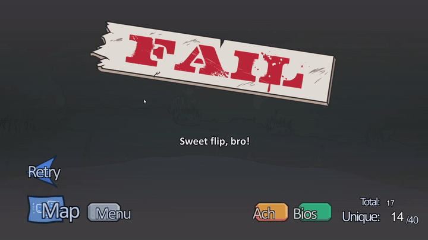
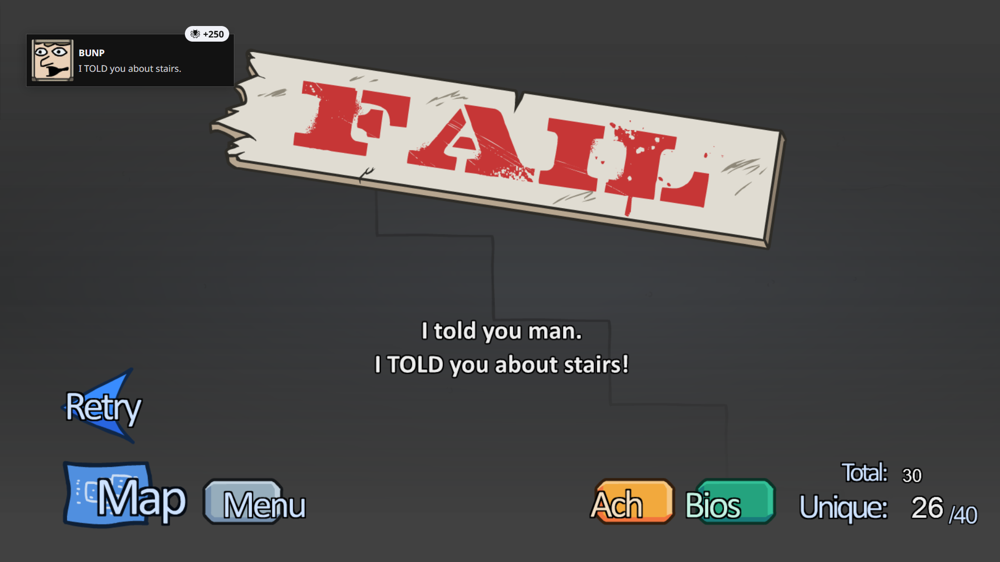

# Мост достижений для Hydra Launcher

## 🇬🇧 [Read in English / Английская версия →](README.md)

[](https://github.com/frocux/hydra-achievements-bridge/actions/workflows/tests.yml)

> **Ребят, эта херня меня реально задолбала — и я решил её починить!!**
> Этот репозиторий перенаправляет достижения в Hydra Launcher. Проблема бесила меня
> огромное количество времени, так что я сделал решение и делюсь с вами)) Пользуйтесь!)

**Это не просто мостик между парой эмуляторов и Hydra — он знает 19 эмуляторов
и около 70 мест, где те прячут достижения.**

**Прогон — буквально секунда.** Живой пример: 4 моста разом (The Henry Stickmin
Collection — 8 достижений, Nodebuster — 13, Click the Button — 9, Moon Sweepers — 8) —
итого 1 секунда. Играть можно, пока он работает в фоне.

**Hydra Launcher видит достижения только по строго заданным адресам. Этот скрипт сам
находит их где угодно ещё и переносит туда, где Hydra их точно прочитает.**

`Python 3.9+` · без сторонних библиотек · Windows

---

## Зачем это нужно

Hydra ищет файлы достижений **только по строго определённым адресам** и всегда в папке
с номером игры (appid). Примерно так:

```
%APPDATA%\GSE Saves\<номер игры>\achievements.json
C:\Users\Public\Documents\Steam\RUNE\<номер игры>\achievements.ini
```

Пока эмулятор аккуратный — всё хорошо. Например, **Carrion**: там эмулятор почти как
настоящий Steam, он сам кладёт достижения куда надо, и Hydra их показывает без всяких
костылей. Трогать такие игры не нужно, скрипт их и не трогает.

А бывает иначе, и тогда достижений в лаунчере нет вообще. Три частых случая:

1. **Эмулятор пишет в незнакомое место.** Некоторые (например SOVEREIGN) складывают
   достижения прямо в свой `.ini` рядом с игрой. Hydra туда не смотрит вообще.
2. **Номер игры потерялся.** Если в `steam_appid.txt` вместо числа написана какая-то
   ерунда, эмулятор не понимает, что за игра, и сваливает всё в папку `0`. Hydra ищет
   в папке со своим номером — и не находит ничего.
3. **Эмулятора вообще нет.** Антивирус съел подменную `steam_api.dll`, осталась родная
   от Valve. Steam-API в игре не поднимается, достижения нигде не копятся — кроме
   собственного сохранения самой игры.

Скрипт лечит все три: находит достижения, сам разбирается, чьей игре они принадлежат,
и перекладывает туда, куда Hydra точно смотрит.

Есть и четвёртый случай, где без моста вообще никак. Мы залезли в исходники Hydra:
для некоторых эмуляторов у неё **нет адресов поиска совсем**. Список, который она
строит для 3DM, ALI213 и UserStats, получается пустым — то есть Hydra эти достижения
не найдёт физически, как бы аккуратно эмулятор их ни складывал. Обновление лаунчера
этого не изменит. Если игра на одном из таких эмуляторов — мост не удобство, а
единственная дорога.

Но и тут достижения должны сначала появиться на диске. Подробнее об этом — ниже,
в разделе «Чего он не умеет».

---

## Как это выглядит

[](media/henry-achievement.mp4)

Чаще всего Генри Стикман кидает свои достижения туда, куда Hydra вообще не смотрит.
Вот на видео ачивка вылезла — а в лаунчере пусто, потому что лежит она в собственной
папке игры в `%APPDATA%`, а не там, где Hydra ищет. Ровно для этого и есть этот мост:
он забирает их оттуда и кладёт куда надо. Открыл ачивку — она уже в Hydra, руками
ничего трогать не надо.

*(клик по картинке — полное видео, 23 секунды)*

А вот вторая, уже из «Stealing the Diamond» — **BUNP. I TOLD you about stairs.**
Тоже вылезла в игре, и мост её спокойно подхватил вместе с остальными.



---

## Что он умеет

| Умение | Как это выглядит на практике |
|---|---|
| **Около 70 мест, 19 эмуляторов** | 50 адресов поиска плюс 18 базовых папок. Знает Goldberg, GSE, CODEX, RUNE, EMPRESS, OnlineFix, SKIDROW, SmartSteamEmu, CreamAPI, RLD!, Reloaded/3DM, DODI, ALI213, Hoodlum/DARKSiDERS, RLE, Razor1911, TENOKE, KaOs и SOVEREIGN — плюс конфиги и сохранения прямо в папке игры |
| **Все известные форматы** | INI во всех видах, JSON Goldberg/EMPRESS, бинарный `stats.bin` SmartSteamEmu, реестр GreenLuma |
| **Незнакомый формат — не беда** | Если файл похож на достижения, скрипт пробует на нём все разборщики по очереди. Новые эмуляторы обычно подхватываются сами, без правок кода |
| **Любая кодировка** | UTF-8, cp1251, UTF-16 — и с меткой в начале, и без. Старые INI от русских репаков читаются как миленькие |
| **Потерянный номер игры** | Раскладывает достижения по играм, сверяя названия со схемами достижений (`steam_settings\achievements.json` в папке игры) |
| **Определяет эмулятор** | Смотрит на файлы игры и пишет в отчёт, какой там эмулятор — и предупреждает, если он не работает |
| **Свои сохранения игр** | Если игра сама ведёт учёт достижений (например Godot-игра в `save.json`), скрипт читает и его, а карту «внутреннее имя → имя в Steam» достаёт прямо из файлов игры |
| **Игры на Adobe AIR** | Flash-порты держат прогресс в `%APPDATA%\<id>\Local Store`, в сжатых `.sav` — скрипт распаковывает их и достаёт оттуда достижения |
| **Реестр Windows** | GreenLuma (там прогресс в реестре) и вообще обход `HKCU\Software` — на случай эмуляторов, которые пишут туда |
| **Тесты на разборщики** | В папке `tests` на каждый основной формат лежит образец — все виды INI, JSON Goldberg/EMPRESS, бинарный `stats.bin` — и тест проверяет, что из него читается ровно то, что должно. Всего 49 проверок. Запуск — `run-tests.bat` (или `python -m unittest discover -s tests -t .`): без библиотек, за пределы временной папки ничего не пишется. Честно: реестр GreenLuma и сохранения Adobe AIR тестами пока не покрыты — там только внимательное чтение кода. Те же тесты гоняются на GitHub Actions при каждом push, на Python 3.9 и 3.12 — это и есть бейдж наверху страницы |

Куда переносит: в `%APPDATA%\GSE Saves\<номер игры>\achievements.json` в формате
Goldberg. Это единственное место, которое Hydra читает **для любого** крака,
поэтому одного файла хватает всем.

Если в `GSE Saves\<номер игры>` уже лежит чужой файл (настоящие сохранения игры) —
скрипт его не трогает, а пишет в запасное место
`%APPDATA%\Goldberg SteamEmu Saves\<номер игры>\achievements.json`.

---

## Чем он отличается от других мостов

Таких инструментов наперечёт, и почти все они узкие: один-два эмулятора и ручная
работа — запустить от администратора, перетащить папку игры в окно программы,
выбрать пункт в меню, держать окно открытым. Здесь подход другой.

| | Обычные мосты | Этот |
|---|---|---|
| Эмуляторы | один-два (чаще всего RUNE и Goldberg) | 19 эмуляторов, около 70 мест, все известные форматы |
| Эмуляторы, которых Hydra не видит вообще | сделать нечего | 3DM, ALI213, UserStats — адресов поиска для них у Hydra нет, дорога только через мост |
| Незнакомый формат | не читается | «нюхач» пробует на файле все разборщики |
| Номер игры потерялся | достижения просто не находятся | раскладываются по играм сверкой со схемами |
| Свой учёт достижений игры | обычно нет | сохранения Godot и Adobe AIR |
| Реестр Windows | редко | GreenLuma + общий обход `HKCU\Software` |
| Настройка | тащить папку в окно, права администратора | одна строка в `roots.txt` или вообще ничего |
| Как работает | пока открыто окно | тихо, из автозагрузки, раз в 10 секунд |
| Антивирус | `.exe`, который Defender иногда съедает | обычный `.py`-скрипт: ругаться не на что |

Плюс он никогда не трогает папки игр и не требует прав администратора.

---

## Установка

1. Нужен Python 3.9 или новее ([python.org](https://www.python.org/downloads/),
   при установке галочка **Add Python to PATH**).
2. Скачай папку с этим файлом куда угодно — например `C:\Tools\hydra-achievements-bridge`.
3. Открой `roots.txt` и впиши папки, где лежат игры, по одной в строке.
   Две самые ходовые (`C:\Games` и `D:\Games`) уже прописаны прямо в скрипте,
   так что если игры лежат там — этот файл можно вообще не трогать:

```
C:\Games
D:\Games
E:\SteamLibrary\steamapps\common
```

4. Запусти `run.bat` (обычный прогон) и посмотри `report.txt` — там написано,
   что нашлось и куда легло.

Проверить, ничего не записывая: `check.bat`.

---

## Запуск

```
python bridge.py                     обычный прогон
python bridge.py --dry-run           только показать, ничего не писать
python bridge.py --watch 10          следить, проверяя раз в 10 секунд (так работает автозапуск)
python bridge.py --watch 30          то же, но реже — заметно легче для диска
python bridge.py --watch             то же, но раз в 30 секунд
python bridge.py --roots E:\Games    добавить папку с играми
python bridge.py --online            разрешить искать номера игр в магазине Steam
python bridge.py --quiet             короткий отчёт
python bridge.py --watch 30 --full   забыть всё найденное, обходить диск начисто
python bridge.py --watch 30 --full-every 60   полный обход раз в 60 секунд
python bridge.py --help              все ключи
```

| Файл | Что делает |
|---|---|
| `check.bat` | примерочный прогон: показывает, что нашёл, но ничего не пишет |
| `run.bat` | обычный прогон |
| `watch.bat` | следит, пока открыто окно, обновляя раз в 30 секунд |
| `autostart-on.bat` | включить автозапуск |
| `autostart-off.bat` | выключить автозапуск и остановить слежение |
| `run-tests.bat` | прогнать тесты на разборщики (ничего не пишет, только проверяет) |

---

## Память обхода

Следя за папками, мост запоминает, что где лежит: список файлов в каждой папке читается
один раз и перечитывается, только если изменилась сама папка. Первый обход читает диск,
следующие его почти не трогают — на 11 играх это десятые доли секунды вместо пары секунд.
Ключ `--full` велит забыть всё и обходить диск начисто каждый раз, `--full-every СЕК` —
раз в столько-то секунд (по умолчанию 120), как страховка.

Одна оговорка: Windows пишет время папки с шагом около 16 мс, и удаление файла его не
всегда меняет. Новый или изменённый файл достижения подхватится на следующем обходе, а
удалённый может продержаться в памяти до полного обхода — максимум две минуты. В обычной
игре файлы достижений никто не удаляет, так что на практике этого не видно.

---

## Автозапуск

`autostart-on.bat` кладёт в папку «Автозагрузка» ярлык такого вида:

```
pythonw.exe  "<папка проекта>\bridge.py" --watch 10
```

`pythonw.exe` — тот же Python, только без чёрного окна. Раз в 10 секунд он просыпается,
тратит секунду на проверку и снова спит. Открыл новое достижение — через десять секунд
оно уже в Hydra.

Никаких прав администратора и никаких служб. Выключить — `autostart-off.bat`:
он убирает ярлык и останавливает уже работающий процесс. Достижения, которые
скрипт успел перенести, при этом никуда не деваются.

Два слежения одновременно запуститься не могут: второе увидит замок `bridge.lock`
и просто выйдет.

**Важно:** Hydra читает достижения не мгновенно. Самый первый раз после прогона
закрой и снова открой Hydra — она перечитает файлы на старте.

---

## Работает в фоне: почему иногда может подлагивать

Мост просыпается раз в 10 секунд, всё проверяет и снова спит. Первый обход читает
диск — на 11 играх это около секунды. Следующие перечитывают только те папки, что
изменились, — обычно десятые доли секунды. У человека с тремя сотнями игр даже это
заметно дольше, и это стоит учитывать.

Честно про возможные подлагивания:

- **Диск просыпается каждые 10 секунд.** Мост читает сохранения и папки эмуляторов.
  На ноутбуке это значит, что диск почти не засыпает, а кулер слышно чаще.
- **Антивирус.** Defender перечитывает файлы, которые мост трогает, — тоже время.
- **Игра и мост читают с одного диска** — в момент обхода может быть микро-заминка.
  На десятке игр её не видно, на огромной библиотеке может быть заметно.

Лечится одной цифрой: поставь `--watch 30` или `--watch 60` вместо 10. Достижение
тогда доедет до Hydra за полминуты, зато в фоне почти ничего не происходит. Если
фоновый мост вообще не нужен — гоняй `run.bat` руками после игры, он делает то же самое.

**Отдельно про плашку в самой игре.** Мы у себя видели такую штуку: при интервале
в минуту достижение в Hydra появлялось, а уведомление в игре не выскакивало. Похоже
на гонку — мост успевает записать файл раньше, чем игра отрисует плашку, и игра
считает достижение уже показанным. Точно причину мы не проверяли. С интервалом
в 10 секунд такого не замечали. Если у тебя плашки пропадают — поставь интервал
покороче (`--watch 5`) и напиши в issues, разберёмся вместе.

---

## Чего он не делает

- **Ничего не удаляет и не меняет в папках игр.** Только читает оттуда и пишет свои
  файлы в `%APPDATA%`.
- Не качает достижения из интернета — переносит только то, что реально наиграно
  на этом компьютере.
- Не трогает файлы, которых не создавал сам: `state.json` помнит список своих.
  Сомневаешься — удали `state.json`, и скрипт перестанет считать старые файлы своими.
- Не требует прав администратора и ничего не ставит в систему.

---

## Если какая-то игра всё равно не видна

Смотри `report.txt`. Там будет одна из надписей:

- **«номер игры потерян... чья папка, непонятно»** — допиши привязку в `games.txt`
  строкой вида `Название папки игры = 1234567`. Номер виден в адресе страницы игры
  в Steam: `store.steampowered.com/app/1234567/`.
- **«в базе Hydra этого номера не нашлось»** — игра не добавлена в библиотеку Hydra.
  Сначала добавь игру, потом гоняй скрипт заново.
- **номер игры выглядит как 480** — это не номер игры, а Spacewar, тестовое приложение
  Valve. Сборщики пишут его в `steam_appid.txt`, чтобы игра просто запустилась. Мост
  такой номер игнорирует: допиши настоящий в `games.txt`.
- **«эмулятор не работает: рядом лежит оригинальная steam_api от Valve»** — подменную
  библиотеку удалил антивирус. Если игра ведёт свой учёт достижений, скрипт вытащит
  их из сохранения. Иначе поможет только переустановка эмулятора.
- **«оба места заняты чужими файлами»** — и в `GSE Saves`, и в
  `Goldberg SteamEmu Saves` уже лежат файлы этой игры не от нас.
- **игры в отчёте нет вообще, а в Hydra пустая страница** — возможно, эмулятор вообще
  ничего не записал. Это отдельная история, про неё ниже: «Когда эмулятор не записал
  вообще ничего».

---

## Чего он не умеет

Чтобы не перехваливать. Мост переносит те достижения, которые уже лежат на диске.
Появиться из ниоткуда он их не заставит и в папки игр не полезет.

### Когда эмулятор не записал вообще ничего

**Если игра не отдала достижение — переносить нечего.** Hollow Knight — это случай
с этого самого компьютера, но дело не в Hollow Knight: любая сборка, чей эмулятор так
и не узнал списка достижений, ведёт себя ровно так же. Понять, что у тебя именно этот
случай, помогают три проверки:

1. **Загляни в файл, который читает Hydra.** У Hollow Knight это
   `C:\Users\Public\Documents\Steam\RUNE\367520\achievements.ini` — он на месте, а внутри
   `Count=0` и ни одного блока `[ИМЯ_ДОСТИЖЕНИЯ]`. Эмулятор файл создал и не записал
   в него ничего. (Сам путь написан в папке игры, в `steam_emu.ini` — строка, которая
   начинается со слов «Game data is stored at».)
2. **Поищи в логе самой игры слово achievement.** Unity-игры держат лог в
   `%USERPROFILE%\AppData\LocalLow\<студия>\<игра>\Player.log`. Игра спрашивает
   эмулятор про свой прогресс и не получает ответа — снова и снова, по каждому
   достижению, при каждом запуске. Цифры из того файла скажут лучше нас:
   ```
   95 Failed to retrieve achievement state for ATTUNEMENT
   89 Failed to retrieve achievement state for ENCHANTED
   88 Failed to retrieve achievement state for CHARMED
   ```
   Для игры это значит, что достижений у тебя нет вообще — поэтому она ни одного
   и не сообщает, а эмулятору нечего записывать.
3. **Проверь, есть ли у эмулятора список достижений, которым он может ответить.**
   RUNE и Goldberg берут описания достижений из папки `steam_settings` рядом с `.exe`
   игры (внутри — `achievements.json`). В этой сборке такой папки нет, то есть
   отвечать эмулятору нечем.

**Наш диагноз — и где он перестаёт быть диагнозом.** Похоже, дело именно в пустом
списке: нет списка — нет ответов — нет записанных достижений. Но мы это не доказали:
у нас один лог одной игры и один файл одного эмулятора, а что RUNE делает внутри, мы
не знаем. Если ты знаешь его кишки лучше нас — напиши, будем рады.

**А вот что знаем точно: сам эмулятор в порядке.** На этом же компьютере, под тем же
RUNE, у другой игры файл заполнен — и с настоящим временем открытия:

```
[COMPLETE_PROLOGUE]
Achieved=1
CurProgress=0
MaxProgress=0
UnlockTime=1780259580
```

То есть «RUNE сломался» — неправда. Дело в конкретной сборке.

**Что можно попробовать** — и всё это внутри папки игры, поэтому мост этого за тебя
не делает:

- дать эмулятору список достижений: положить рядом с `.exe` игры нормальный
  `steam_settings\achievements.json` (имена и номера есть на странице игры в Steam);
- взять другую сборку той же игры — ту, где список достижений идёт в комплекте;
- если игра ведёт свой учёт достижений, мост умеет читать прогресс оттуда
  (см. «Свои сохранения игр» выше) — но только если игра его ведёт;
- или забить и пойти играть. Hydra читает тот же самый пустой файл, так что от тебя
  ничего не прячут — достижений на диске правда нет.

**Некоторые эмуляторы держат достижения в памяти и сбрасывают на диск позже** — или
при выходе из игры. RUNE как раз из таких: поиграл, вышел из игры, дал мосту пройтись —
вот теперь они в Hydra.

**Прогресс, который живёт на сервере, не скопируешь.** У некоторых сборок достижения
ведутся онлайн. Локально брать нечего.

**Безымянные достижения остаются безымянными.** SmartSteamEmu хранит не имена, а их
CRC32, поэтому в отчёте будет что-то вроде `crc:a1b2c3d4`. Переносятся они как есть,
но сверить их с настоящими достижениями игры невозможно — красивых значков в Hydra
ждать не стоит.

**Только Windows** — все эти адреса windows-ные.

**И сломанный эмулятор он не починит.** Если антивирус съел подменную библиотеку, мост
вытащит достижения только из сохранения самой игры — если игра его ведёт. Переустановка
эмулятора — отдельная работа.

---

## Можно менять под себя

Лицензия **MIT** — то есть бери и делай что хочешь: меняй, вырезай, переписывай,
вставляй в свои сборки, выкладывай дальше. Условие одно: сохрани текст лицензии
и не удивляйся, если что-то не заработает :) Для этого и выложено.

Что удобно: **это один файл на чистом Python**, без сборки, без библиотек, без
установки. Скачал, открыл в блокноте — и правишь.

Где что лежит:

| Хочу | Куда смотреть |
|---|---|
| Добавить свою папку эмулятора | таблица `LOCATION_TEMPLATES` в начале `bridge.py` — одна строка |
| Добавить базу, от которой пляшут пути | `EMU_BASE_DIRS` там же |
| Научить узнавать новый эмулятор по файлам | `EMU_MARKERS` там же |
| Разобрать незнакомый формат файла | разборщики `parse_ini`, `parse_json_achievements`, `parse_sse_bin` и «нюхач» `sniff_file`, который пробует их по очереди |
| Поменять частоту проверки | ключ `--watch`, а для автозапуска — цифра в ярлыке |
| Заставить забыть найденное | `--full`, а для редкого полного обхода — `--full-every СЕК` |
| Свои папки с играми и привязки | `roots.txt`, `games.txt` |
| Игры со своим учётом достижений | `local-saves.json` |
| Проверить, что ничего не сломал | `run-tests.bat` — на основные форматы свой тест, образцы в `tests/samples` |

Комментарии в коде на русском, каждая таблица подписана словами — разберётся даже
новичок. Форкай, дописывай свои эмуляторы, присылай правки: таблицы для этого
и сделаны, там ничего сложного.

---

## Файлы

```
bridge.py               сам скрипт
README.md               эта страница на английском (главная)
README.ru.md            она же по-русски
LICENSE                 лицензия MIT
roots.txt               папки с играми (впиши свои)
games.txt               ручные привязки «папка игры = номер игры»
local-saves.json        ручные карты имён для игр со своим учётом достижений
state.json              какие файлы создал скрипт (появляется после прогона)
report.txt              отчёт последнего прогона
bridge.lock             замок: чтобы два слежения не запустились разом
steam-cache.json        кэш поиска номеров в Steam (только с ключом --online)
local-saves-cache.json  кэш разбора файлов игр
check.bat, run.bat, watch.bat, autostart-*.bat   запускалки для Windows
autostart-on.ps1, autostart-off.ps1              работа автозапуска
roots.example.txt, games.example.txt             шаблоны настроек
run-tests.bat                                    прогон тестов
tests/                                           тесты и образцы форматов для них
.github/workflows/                               те же тесты на каждый push (GitHub Actions)
media/                                           картинки и видео для этого README
```

---

## Как это работает внутри

- Точки поиска и форматы описаны таблицами в начале `bridge.py` — добавить новый
  эмулятор обычно значит дописать одну строку в таблицу.
- Если файл похож на достижения, но формат незнакомый, включается «нюхач»: он пробует
  на файле все разборщики по очереди.
- Странные папки вроде `GSE Saves\0` разбираются по смыслу: названия достижений
  сверяются со схемами игр, и каждое уходит своей игре.
- Карта «внутреннее имя → имя в Steam» для игр со своим учётом достижений строится
  из файлов самой игры (в Godot-играх настоящее имя достижения лежит строкой сразу
  после его описания `...__DESC`).
- У игр на Adobe AIR файлы из `Local Store` распаковываются как сырой deflate,
  а внутри читаются записи «длина + текст».
- Достижения в реестре ищутся только чтением: сначала известные ветки GreenLuma,
  потом общий обход `HKCU\Software` на небольшую глубину.
- Свои файлы пишутся через временный и подменяются одним движением (`os.replace`) —
  недописанный файл Hydra не увидит. Прежнее содержимое остаётся рядом как `.bak`.

Идеи и форматы подсмотрены в открытых проектах
[Achievement Watcher](https://github.com/xan105/Achievement-Watcher) и
[Hydra Launcher](https://github.com/hydralauncher/hydra). Спасибо их авторам.

Автор: **frocux**.

---

## Лицензия

MIT — делай что хочешь, только не жалуйся, если что-то не заработало.
Текст лицензии в файле [LICENSE](LICENSE).
